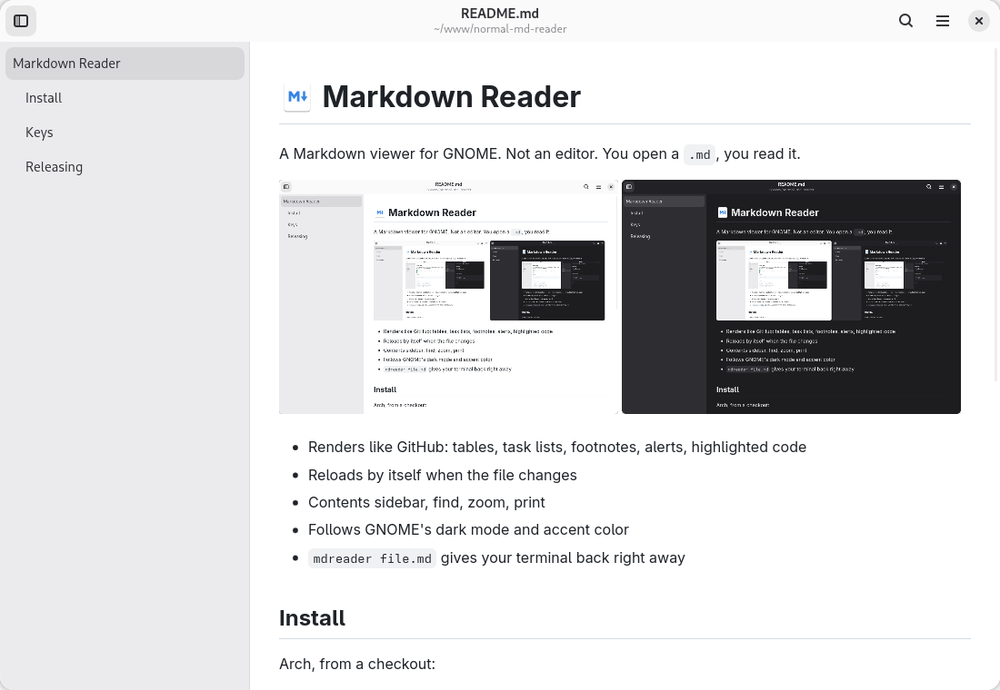
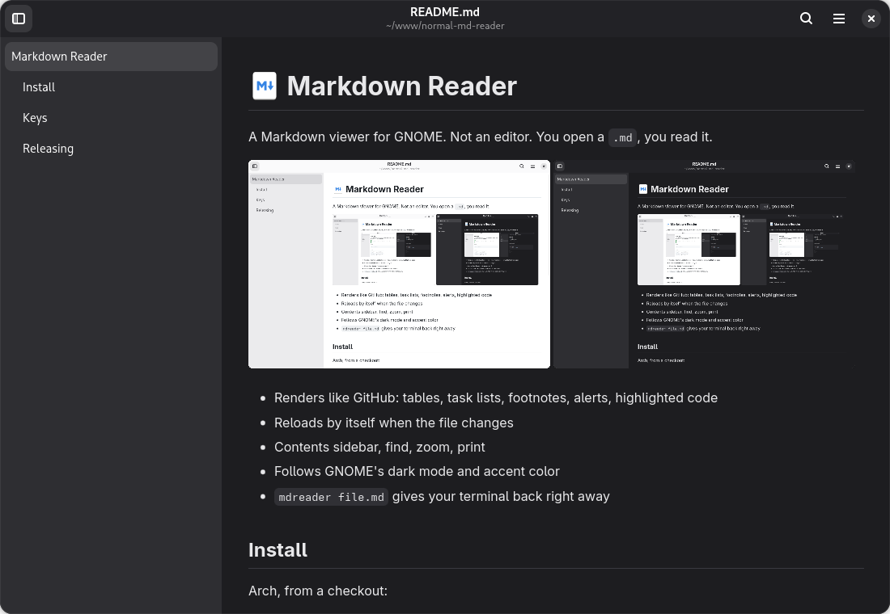

#  Markdown Reader

A Markdown viewer for GNOME. Not an editor. You open a `.md`, you read it.

<p>
  
  
</p>

- Renders like GitHub: tables, task lists, footnotes, alerts, highlighted code
- Reloads by itself when the file changes
- Contents sidebar, find, zoom, print
- Follows GNOME's dark mode and accent color
- `mdreader file.md` gives your terminal back right away

## Install

Arch, from a checkout:

```sh
makepkg -si
```

Or download the `.pkg.tar.zst` from [Releases](../../releases) and `sudo pacman -U` it.
Without a package: `make install` puts it in `~/.local`.

To open `.md` files with it by default:

```sh
make default
```

## Keys

<kbd>Ctrl</kbd>+<kbd>O</kbd> open ·
<kbd>Ctrl</kbd>+<kbd>F</kbd> find ·
<kbd>F9</kbd> contents ·
<kbd>Alt</kbd>+<kbd>←</kbd> back ·
<kbd>Ctrl</kbd>+<kbd>P</kbd> print ·
<kbd>Ctrl</kbd>+<kbd>+</kbd>/<kbd>-</kbd>/<kbd>0</kbd> zoom

## Releasing

Bump `VERSION` in `mdreader.py` and `pkgver` in `PKGBUILD`, then push a `v<version>` tag.
CI builds the package and publishes the release.
